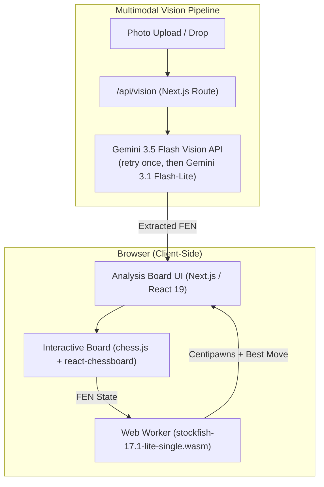

# Chess Vision Analyzer

Upload a photo of a chessboard, get a FEN, and see what Stockfish thinks, all in one page. Photo recognition uses Gemini's vision API; the engine runs in your browser as WebAssembly.

> **Status:** The engine, board editor, FEN loader and presets are tested. Photo recognition has been tested only on the included sample photo (an AI-generated image, see below), not yet on real board photos. Treat detected FENs as a starting point and check them on the board before trusting the evaluation.

---

## What It Does

- **Photo to FEN.** Sends the image to Gemini 3.5 Flash and asks for a FEN. The result loads onto the board, where you can correct any misread pieces. See [Photo recognition details](#photo-recognition-details) for retries, the fallback model and test results.
- **Stockfish in the browser.** Stockfish 17.1 (lite, single-threaded WASM) runs in a Web Worker. No engine server, and no special COOP/COEP headers, because the single-threaded build doesn't need `SharedArrayBuffer`. It shows the evaluation in pawns from White's point of view (`+0.31` = White better, `M-3` = Black mates in 3) and draws the best move as an arrow.
- **Board editor.** Play legal moves, or rearrange freely using the spare-piece bank, right-click to delete, and a White/Black-to-move toggle. Paste or copy FENs from the bar above the board.
- **Presets.** Standard start, Ruy Lopez, Sicilian, Morphy's Opera Game, Lucena position.

## Things To Know

- **Photos leave your machine.** When you use photo recognition, the image goes to a Next.js API route (`/api/vision`), which forwards it to Google's Gemini API. Manual editing, FEN loading and engine analysis stay local.
- **Your API key.** If you enter it in the app, it is kept in `localStorage` and sent with each recognition request to your own server route. A `GEMINI_API_KEY` in `.env.local` works too and is used when no key is supplied by the browser.
- **The engine is not at full strength.** `lib/engine.ts` sets `UCI_LimitStrength` with `UCI_Elo 2200`, so move suggestions are those of a strong club/master-level player rather than the engine's maximum. Remove those `setoption` lines to analyze at full strength.
- **Speed.** In local tests the lite engine reached depth 10-12 on middlegame positions in a few tens of milliseconds. The app requests depth 15 by default. Photo recognition is much slower: about 35 seconds per photo, longer if a retry is needed (see below).

---

## Photo Recognition Details

How `/api/vision` handles a photo:

1. It asks **Gemini 3.5 Flash** (default thinking) for a FEN.
2. If the answer is an error, contains no FEN, or is malformed (a rank that does not add up to 8 squares), it asks **3.5 Flash once more**.
3. If both attempts fail, **Gemini 3.1 Flash-Lite** answers as a last resort. Its result is flagged `lowConfidence` and the app shows a warning instead of "Board detected!".
4. An invalid API key (HTTP 400/401/403) fails immediately without retries.
5. In the app, a detected position that can't be loaded (for example two white kings, or more than 16 pieces or 8 pawns on one side) is kept in the FEN bar with the reason shown, so you can fix the misread squares and press **Load**. Stockfish refuses boards with more than 16 pieces a side, so these are rejected before they reach the engine.

Change the models with `GEMINI_MODELS=primary,fallback` in `.env.local` if Google retires these.

**Test results on `public/samples/midgame_board.jpg`**, scored against a manual square-by-square reading (58 squares; 6 ambiguous squares excluded; empty squares count):

| Setup | Time per photo | Squares correct |
| :--- | :--- | :--- |
| 3.5 Flash, default thinking (used) | 34-42 s | 54, 58, 58, 54, 58, 58 |
| 3.5 Flash, `thinkingLevel: "low"` (rejected) | 15-44 s | 57, 58, 46, 55, 52, 54, 56; 3 of 7 were malformed FENs |
| 3.1 Flash-Lite (fallback only) | 1-2 s | 38, 40 |

Caveats:

- The sample photo is AI-generated and shows an **illegal position** (Black has nine pawns), so even a perfect read is not a legal FEN. Accuracy on real board photos is still unmeasured.
- A wrong answer can still pass every check if each rank adds up to 8 squares. Always check the loaded board.
- Requests can take 35-80 seconds. Hosting platforms with short function timeouts (for example 10-30 s) will cut them off.

---

## Architecture



---

## Tech Stack

| Layer | Technology |
| :--- | :--- |
| **Framework** | Next.js 16 (App Router, Turbopack) |
| **Language** | TypeScript 5 |
| **UI & Styles** | Tailwind CSS v4 (via `@tailwindcss/postcss`), Lucide React |
| **Board & Rules** | `chess.js`, `react-chessboard` |
| **Vision AI** | Google Gemini 3.5 Flash (3.1 Flash-Lite as low-confidence fallback) |
| **Chess Engine** | Stockfish 17.1 single-threaded WebAssembly (7.2 MB WASM) |

---

## Getting Started

### 1. Prerequisites
- Node.js 18+ (Node.js 20+ recommended)
- npm or pnpm

### 2. Installation
```bash
git clone https://github.com/mmkaya-ui/chessanalyzer.git
cd chessanalyzer
npm install
```

### 3. Configure Gemini Vision (Optional)
To use the photo recognition feature, you need a Google Gemini API key:
- **Option A (In-App):** Launch the app, click **"AI Vision API Key"** in the top navigation, and paste your key. It is saved in your browser's `localStorage`.
- **Option B (.env.local):** Create a `.env.local` file:
  ```env
  GEMINI_API_KEY=your_gemini_api_key_here
  ```
*(Without an API key, the manual board editor, FEN loader, presets, and Stockfish engine all function completely out of the box.)*

### 4. Run Development Server
```bash
npm run dev
```
On Windows you can also double-click `start-dev.bat`. Open [http://localhost:3000](http://localhost:3000) and click **Start Analysis**.

### 5. Production Build
```bash
npm run build
npm start
```

---

## Project Structure

```text
chessanalyzer/
├── app/
│   ├── analysis/page.tsx      # Main analysis workspace (board, FEN bar, presets)
│   ├── api/vision/route.ts    # Multimodal Gemini vision endpoint
│   ├── layout.tsx             # Root layout and theme wrapper
│   └── page.tsx               # Landing page
├── components/
│   ├── AnalysisPanel.tsx      # Centipawn eval & best-move display
│   ├── ChessboardWrapper.tsx  # Dynamic react-chessboard wrapper
│   ├── SparePieces.tsx        # Drag-and-drop piece bank
│   └── UploadZone.tsx         # Drag-and-drop board photo uploader
├── lib/
│   ├── engine.ts              # Web Worker Stockfish controller & queue
│   └── vision.ts              # Client-side image upload & BYOK handler
└── public/
    ├── stockfish-17.1-lite-single-03e3232.js    # Single-threaded WASM loader
    ├── stockfish-17.1-lite-single-03e3232.wasm  # Stockfish 17.1 binary (7.2 MB)
    └── samples/                                # Sample board photographs
```
