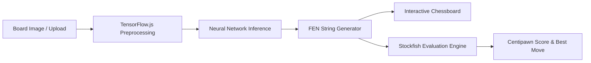

# Chess Vision Analyzer — Board State Recognition & Engine Analysis

An interactive computer vision and chess analysis platform built with **Next.js**, **TensorFlow.js**, and **Stockfish**. It allows players to capture or upload physical chessboards, convert raw images into FEN (Forsyth-Edwards Notation) strings using browser-based neural network inference, and evaluate tactical positions instantly.

---

## Key Features

- **Client-Side Neural Network Inference:** Leverages `@tensorflow/tfjs` in the browser for fast, privacy-preserving board state extraction without heavy server GPUs.
- **Custom Model & Graph Support:** Capable of loading custom TensorFlow Graph Models (`model.json` + binary weights) directly in the browser via `tf.io.browserFiles`.
- **Integrated Stockfish Engine:** Deep position evaluation, best move recommendation, and centipawn advantage tracking.
- **Interactive Board Visualization:** Edit detected board states, play out suggested engine variations, and inspect tactical opportunities.

---

## Pipeline



---

## Tech Stack

- **Framework:** Next.js (TypeScript)
- **Computer Vision / ML:** TensorFlow.js (`@tensorflow/tfjs`)
- **Chess Engine:** Stockfish WASM / Native binaries
- **Styling:** Tailwind CSS

---

## Getting Started

### 1. Installation

```bash
git clone https://github.com/mmkaya-ui/chessanalyzer.git
cd chessanalyzer
npm install
```

### 2. Run Development Server

```bash
npm run dev
```

Visit [http://localhost:3000](http://localhost:3000).
